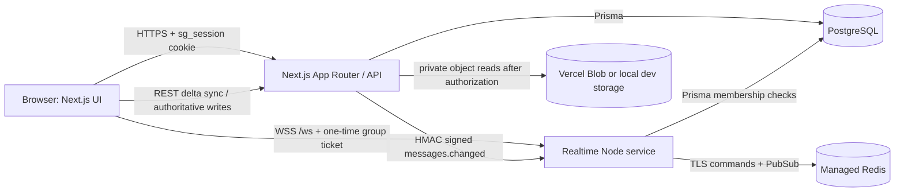

# Study-Group Architecture and Production Operations

This document describes the repository's current architecture and a production deployment that keeps the existing REST application available on Vercel while hosting long-lived WebSocket connections on a separate persistent Node process.

## System topology

The durable source of truth is PostgreSQL. The Next.js App Router owns user-facing pages, authenticated REST endpoints, session issuance, group-level authorization, persisted chat writes, notes, tasks, sessions, resources, and uploads. Prisma maps those APIs to PostgreSQL. The `lib/groups.ts` membership/role helpers and the shared API wrapper centralize server-side checks. The middleware cookie-presence gate is a page-navigation convenience, not an API authorization boundary.

Files are accessed through the authenticated `/api/uploads/[...key]` route. New Vercel Blob objects are private; the route checks uploader/group access and proxies the object bytes with private/no-store headers. Local disk storage is for development only. Previously uploaded public Blob objects are a migration exception described in the security report.

## Realtime collaboration

WebSockets are optional and run in `server/realtime.mjs` as a separate Node process. Vercel's serverless Next routes do not host persistent socket connections. A user who opens a group's Discussion view requests `POST /api/realtime/tickets`; that route confirms current group membership and returns a 60-second, one-use, HS256 JWT scoped to exactly one user and group. The client sends the ticket as its first WebSocket text frame to `/ws`.

The companion checks the exact HTTP(S) browser-origin allowlist, token issuer/audience/expiry, ticket replay, and database membership. It rechecks membership while the socket is open (nominally every 10 seconds). Ticket expiration only limits the authentication handshake; it does not close an authenticated socket. The service accepts only small text frames and disables per-message compression.

Redis is the shared ephemeral coordination layer. Each service replica keeps only its own sockets locally; per-connection presence and typing leases live in Redis sorted sets with expirations, and snapshots aggregate users across connections/replicas. Redis Pub/Sub distributes presence, typing, and signed message-change metadata to the replicas that currently hold group sockets. Ticket IDs are redeemed with an atomic `SET NX PX`; Lua fixed-window counters enforce upgrade-IP, auth-IP, publish-IP, publish-actor, and typing-user limits globally. Default limits are 300 upgrades/IP/minute, 60 auth attempts/IP/minute, 6 typing frames per group/user/second, 6,000 publishes/IP/minute, and 120 publishes/actor/minute; positive integer overrides are documented in `.env.example`.

Message create/edit/delete/reaction/pin operations still write through authenticated REST handlers. After the database mutation succeeds, Next best-effort publishes a timestamped HMAC-SHA256-signed `messages.changed` event to the companion. That event contains only group, actor, and timestamp metadata—never message content. Clients respond by fetching authorized deltas from `GET /api/groups/[id]/sync`. If the socket is missing, delayed, or disconnected, REST polling remains the fallback. The Discussion chat component is loaded only when its tab is selected.

Redis Pub/Sub is ephemeral, not a durable event log. If either Redis connection is interrupted, `/healthz` becomes unready, new upgrades receive 503, and existing sockets close on the next maintenance check (at most about one second) so clients reconnect; a missed invalidation is repaired by the authoritative REST sync path. Redis loss must not be treated as successful distributed coordination. PostgreSQL and REST remain the durable system of record.

## Runtime and trust boundaries

| Component | Responsibility | Required trust controls |
|---|---|---|
| Browser | UI, REST requests, ephemeral socket frames | HttpOnly session cookie; no bearer group data in socket events; exact allowed origin |
| Next.js | Auth, validation, authorization, durable mutations, ticket issuance and signed event publication | `JWT_SECRET` (minimum 32 UTF-8 bytes); server-only credentials; `withUser` same-origin/Fetch Metadata checks; `requireMembership`/`requireRole` |
| PostgreSQL | Users, memberships, messages, tasks, notes, sessions, resources, invitations and durable state | TLS/managed network policy, least-privilege credentials, backups, migrations via deployment job |
| Realtime Node | Socket connections, local socket routing, membership rechecks, message-change fanout | Node.js 20+; dedicated 32-byte ticket and publish secrets; exact origin allowlist; network-restricted `/publish`; TLS reverse proxy for `/ws`; Redis readiness |
| Redis | Shared expiring presence/typing leases, atomic rate limits and ticket replay, cross-replica Pub/Sub | Private network; TLS/authentication; least-privilege Redis account and dedicated logical database/namespace; managed HA and monitoring |
| Blob storage | Uploaded object bytes | Private write access, server-side authorized reads, no public provider URL returned for new files |

The session cookie is HttpOnly, SameSite=Lax, path `/`, and Secure in production. Session JWT lifetime is seven days. The shared authenticated API wrapper rejects requests marked `Sec-Fetch-Site: cross-site` and mismatched supplied `Origin`/`Referer`; requests that omit these headers are allowed for non-browser API clients. The expected origin uses the request `Host` and, when present, `X-Forwarded-Proto`; a TLS-terminating proxy must preserve the public `Host` and overwrite the forwarded-protocol header rather than passing client input through. This is an origin defense, not a CSRF synchronizer token.

## Environment configuration

Start from `.env.example`. Never commit real `.env` files or place any of these secrets in `NEXT_PUBLIC_*` variables.

| Variable | Where | Production guidance |
|---|---|---|
| `DATABASE_URL` | Next app and realtime service | Same PostgreSQL database/schema; use TLS and a connection-pooler URL suited to serverless functions where needed. Do not print the URL. |
| `JWT_SECRET` | Next app | At least 32 random UTF-8 bytes. Rotating it invalidates existing sessions. |
| `REALTIME_TICKET_SECRET` | Next app and realtime service | Independently generate at least 32 random bytes; must match on both services. |
| `REALTIME_PUBLISH_SECRET` | Next app and realtime service | A different random secret of at least 32 bytes; HMAC-signs internal invalidation events. |
| `REALTIME_PUBLIC_URL` | Next app | Browser-facing `wss://host/ws`; must use the exact `/ws` path. |
| `REALTIME_ALLOWED_ORIGINS` | Realtime service | Comma-separated exact `https://` app origins; no wildcard, path, or untrusted preview origin. |
| `REALTIME_PUBLISH_URL` | Next app | Reachable service `/publish` endpoint; prefer a private network route and firewall it from public callers. |
| `REALTIME_HOST`, `REALTIME_PORT` | Realtime service | Bind privately/loopback behind a WebSocket-capable TLS proxy where possible. The `.env.example` uses local development values. |
| `REDIS_URL` | Realtime service only | Use a private managed endpoint with authentication and TLS (`rediss://`) in production. The web app does not connect to Redis. |
| `REALTIME_REDIS_PREFIX` | All replicas in one environment | Share one namespace across that environment; use distinct namespaces for staging and production. |
| `REALTIME_TRUST_PROXY` | Realtime service | Default `false`. Enable only when a trusted proxy overwrites `X-Forwarded-For`; otherwise client-supplied addresses could bypass or poison IP limits. |
| `REALTIME_*_LIMIT_*` | Realtime service | Positive integer ceilings; start with the documented defaults, monitor 429s, and tune against observed traffic. |
| `STORAGE_PROVIDER`, `BLOB_READ_WRITE_TOKEN` | Next app | Set `STORAGE_PROVIDER=BLOB` and a server-only token when persistent cloud uploads are enabled. |
| `AI_PROVIDER`, `OPENAI_API_KEY`, `OPENAI_MODEL` | Next app | Optional; server-only API key. |

Generate secrets independently, for example with Node's `crypto.randomBytes(32)`. Do not reuse the JWT key as either realtime key.

## Production deployment sequence

1. Provision PostgreSQL with encrypted backups. If enabling realtime, provision a managed Redis instance with TLS, authentication, private networking, and operational monitoring. Configure the production `DATABASE_URL`, the 32-byte session key, and optional Blob/AI values in the hosting secret manager.
2. Configure the realtime secrets, Redis URL/namespace, and public/internal URLs. `REDIS_URL` is required only by the companion. The app can be deployed without realtime and continues with REST sync. Ensure each companion host is persistent and can reach PostgreSQL and Redis.
3. Build/deploy the Next.js application. On Vercel, the configured `npm run vercel-build` runs `prisma generate`, `prisma migrate deploy`, and `next build`. Run this migration path once per release; do not run competing migration jobs against production.
4. After the schema is ready, deploy the matching source revision as one or more `npm run start:realtime` replicas. Each process connects to PostgreSQL and Redis before listening. Put `/ws` behind TLS and allow WebSocket upgrade headers. Restrict `/publish` to the app's private route if the platform supports it; its HMAC remains mandatory in any case.
5. Set the exact app origin in `REALTIME_ALLOWED_ORIGINS`, one shared `REALTIME_REDIS_PREFIX` across replicas, and verify that browser tickets contain the intended `wss://.../ws` URL. Session stickiness is not needed for group state; Redis must be reachable from every replica.
6. Verify `GET /api/health` from the app (database/configuration/migration readiness), `GET /livez` privately on the companion (process liveness), and `GET /healthz` (Redis command and subscriber readiness). These probes reveal no credentials.
7. Run the realtime protocol tests and API E2E suite against a disposable/staging database before release. Do not run test cleanup against a production database. Monitor app HTTP errors, DB pool saturation, socket reconnect rates, membership-denial closes, and proxy upgrade failures.

For a non-Vercel host, use the same ordering but run `prisma migrate deploy` as one release job, then start the Next.js server and the persistent realtime process separately. Do not use `prisma db push` as a production migration strategy.

## Failure behavior and operations

- **Realtime unavailable:** REST chat remains available. Connected clients reconcile slowly; disconnected clients fall back to the existing faster polling and reconnect with jittered backoff.
- **Redis unavailable:** the companion reports not-ready; distributed ticket redemption and rate-limited actions fail closed, while active sockets close with a retryable status. Restore Redis connectivity; REST data remains available. Pub/Sub notifications missed during an outage are not replayed, so REST sync remains essential.
- **Database unavailable:** app health reports degraded status; the companion refuses startup if it cannot connect. Do not serve a misleading healthy state from the web app.
- **Membership removed:** API access is denied immediately; connected sockets are closed after the next bounded membership recheck.
- **Bad origin/ticket/signature:** the socket upgrade is rejected, ticket auth fails, or `/publish` returns 401; do not disable these checks to work around proxy configuration.
- **Scaling:** multiple realtime replicas are supported when all use the same healthy Redis endpoint and namespace. Redis Pub/Sub is best-effort; it does not replace REST delta reconciliation or provide durable delivery. Add load/failure testing and verify provider-specific Redis cluster/managed-service compatibility before increasing scale.
- **Key rotation:** deploy matching realtime ticket/publish secret values to both services together. Rotate `JWT_SECRET` deliberately because all existing sessions will be invalidated.

## Related references

- [REST API reference](API.md)
- [Security audit and production caveats](SECURITY_AUDIT.md)
- [Environment variable example](../.env.example)
